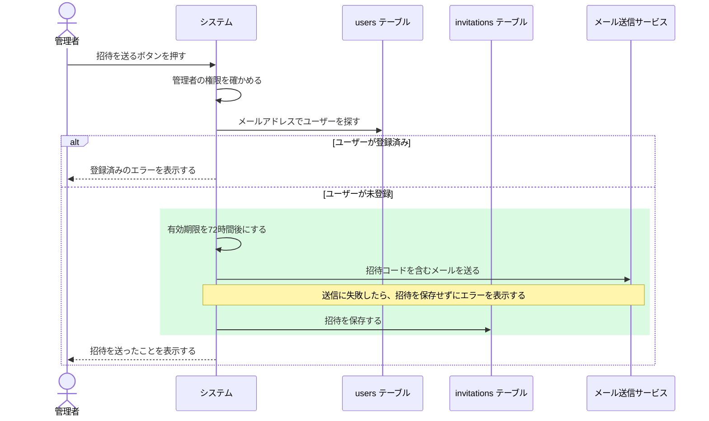

# 処理の図の描き方

このファイルは、Issue に載せる Mermaid の図を決めて描く手順です。
図は、システムをブラックボックスとして外から見て、
どの操作をすると、最終的にどのアクションが行われるかを示します。
考え方は [mizchi/explainer](https://github.com/mizchi/explainer) の図の規則をもとにしています。

## 目次

- [図で見せること](#図で見せること)
- [システムの中で書くこと](#システムの中で書くこと)
- [図を描くかどうか](#図を描くかどうか)
- [図を描く手順](#図を描く手順)
- [Mermaid の書き方の規則](#mermaid-の書き方の規則)
- [図の例](#図の例)

## 図で見せること

図には、操作と、その操作で最終的に行われるアクションだけを描きます。
アクションとは、システムの外から確かめられる結果のことです。
DB への保存、外部 API の呼び出し、メールや通知の送信、ファイルの書き出し、
キューへのジョブの登録、キャッシュの削除、画面に表示する内容はどれもアクションです。

UseCase、Repository、Service のような内部のクラスや、クラスの依存関係は描きません。
システムは1つの箱として描きます。
筆者が知りたいのは、変更によって外から見た動きがどう変わるかだからです。
内部の構成は、変更ファイルのツリーとコード例で分かります。

## システムの中で書くこと

操作からアクションまでの間に、次のような結果を左右することがあれば、図に書きます。
書かないと、なぜそのアクションになるのかが図から読めないからです。

-   判定。入力の検証、権限の確認、重複の確認、状態による分岐などです。
-   失敗したときの扱い。ロールバック、リトライ、後続のアクションを止めるか、などです。
-   アクションの順序に意味がある場合の、その理由。
    `メールを送ってから招待を保存する` のように、順序を変えると結果が変わる場合です。
-   非同期の境目。キューに入れた後、別のプロセスがアクションを行う場合です。
    この場合は、システムを `API` と `ワーカー` の2つの参加者に分けます。
    操作した人に結果が返る時点と、アクションが行われる時点が違うことが分かるからです。
-   アクションに渡す値のうち、筆者が確かめたいもの。有効期限の計算などです。

結果を変えないことは書きません。
ログの出力、値の詰め替え、内部のクラスの呼び出しの順序などです。
書くことが多くて図が読みにくくなる場合は、操作を分けて図を2枚にします。

## 図を描くかどうか

次のどれかに当てはまる操作について描きます。

-   操作によって行われるアクションが、追加されるか、変わるか、なくなる。
-   アクションの順序が変わる。
-   条件によって、行われるアクションが分かれる。

次の場合は描きません。
文のほうが短く正確に伝わるからです。

-   外から見たアクションが変わらない変更。内部のリファクタリングなどです。
-   行われるアクションが1つだけで、1文で説明できる変更。

1つの操作に、図は1枚です。
図の前に、`招待を送るボタンを押すと、最終的に何が行われるか。` のように、
図で答える問いを1文で書きます。

## 図を描く手順

### 操作とアクションを書き出す

図を描く前に、操作ごとに、行われるアクションを順に箇条書きにします。
既存のアクションは、操作の入り口から、システムの外に出ていく呼び出しまでコードをたどって確かめます。
外に出ていく呼び出しとは、DB クライアント、HTTP クライアント、SDK、
ファイルやキューへの書き込み、画面への応答です。

```bash
# 操作の入り口になるルートやハンドラ
rg "router\.(get|post|put|delete)" src

# システムの外に出ていく呼び出しの例
rg "\.(save|create|update|delete|insert)\(|fetch\(|new .*Client\(|writeFile|enqueue" src
```

検索するパターンは、リポジトリで使っているライブラリに合わせて変えます。
新しく作るアクションは、作業ステップのコード例から書き出します。
図の直後には、行われるアクションの一覧と、根拠のファイルを書きます。
図と書き出した箇条書きが食い違ったら、図のほうを直します。

### Mermaid で描く

書き出したアクションだけを、`sequenceDiagram` で描きます。
箇条書きにないアクションを、図に足しません。

### 構文を確かめる

`npx` が使える場合は、Mermaid の CLI で図を描画して、構文の誤りを確かめます。

```bash
npx -y @mermaid-js/mermaid-cli -i diagram.mmd -o diagram.svg
```

エラーが出たら直し、描画できるまで繰り返します。
`npx` が使えない場合は、下の規則と照らし合わせて読み直します。

## Mermaid の書き方の規則

-   参加者は、操作する人、システム、アクションの相手にします。
    アクションの相手とは、DB のテーブル、外部サービス、ファイル、キューのように、
    システムの外でアクションを受けるものです。
-   システムは1つの参加者にし、内部のクラスを参加者にしません。
    非同期の処理がある場合に限り、システムを API とワーカーの2つに分けます。
-   アクションの相手は、確かめたい単位で分けます。
    DB ならテーブルごと、外部サービスならサービスごとに分けます。
-   矢印のラベルには、`招待を保存する` のように、アクションの中身を書きます。
    名前は、用語の対応表にある語を使います。
-   システムの中の判定は、`App->>App: 管理者の権限を確かめる` のように、
    システムから自分への矢印で書きます。
    理由や補足は `Note over App: ...` で書きます。
    どちらも、内部のクラス名や関数名ではなく、何をするかを日本語で書きます。
-   この Issue で追加するアクションは `rect` で囲み、緑の背景にします。
    変更するアクションは黄色、なくなるアクションは赤の背景にします。
    色の意味は、図の直後の文に書きます。
-   結果が条件で分かれる場合は、`alt` と `else` で分けます。
    失敗したときに、どのアクションが行われないかも分かるようにします。
-   参加者の ID は ASCII で書き、表示する名前は `as` の後に書きます。
    日本語の ID は、レンダラーによって描画に失敗します。

## 図の例

この例の問いは、`管理者が招待を送るボタンを押すと、最終的に何が行われるか。` です。



緑の背景のアクションは、この Issue で追加します。
メールを先に送るのは、送信に失敗した招待を DB に残さないためです。

この操作で最終的に行われるアクションは、次の3つです。

- 招待コードを含むメールを送る。
- 招待を保存する。
- 招待を送ったことを表示する。

根拠のファイルは、次のとおりです。

- 管理者の権限の確認は、`src/middlewares/require-admin.ts` にある。
- メールアドレスでユーザーを探す処理は、`src/repositories/user-repository.ts` にある。
- 招待の保存とメールの送信は、Step 2 と Step 3 のコード例で追加する。
